# 📊 Llama 3.2-1B LoRA Fine-Tuning for News Analysis
## Enhanced Semantic Metadata Generation for AI Industry News

[](https://www.python.org/downloads/)
[](https://opensource.org/licenses/MIT)
[](https://huggingface.co/Truthseeker87)

---

## 🚀 Project Evolution: Pilot (v1) to Version 2

> **This is Version 2**, the second iteration of the pilot project.

### 📈 Dataset Expansion: 4.5x Growth

This project represents the **second iteration** of fine-tuning Llama 3.2-1B for AI news metadata generation:

| Version | Dataset Size | Status | Links |
|---------|--------------|--------|-------|
| **v1 (Pilot)** | 101 hand-annotated examples | Proof of concept | [GitHub](https://github.com/youshen-lim/llama-tinker-lora-news-enhancer) • [Hugging Face](https://huggingface.co/Truthseeker87/llama-tinker-lora-news-enhancer) |
| **v2 (Current)** | **460 hand-annotated examples** | Current version | This repository |

### 🎯 Key Improvements in v2

- ✅ **4.5 times as many examples as v1** (101 to 460 examples)
- ✅ **Three-model comparison** (Baseline, Tinker API, Unsloth) instead of single approach
- ✅ **Comprehensive evaluation** with statistical significance testing
- ✅ **Expanded documentation** of the methodology. The training notebook is not yet published.
- ✅ **Valid JSON for all 96 test items** from both fine tuned models

This project uses a larger dataset than v1 and evaluates three models on a 96 item held out test set.


## 🎯 Executive Summary

This project presents a comprehensive evaluation of **LoRA fine-tuning approaches** for enhancing AI-related news content with rich semantic metadata. Using **meta-llama/Llama-3.2-1B** as the base model, we compare three approaches across **460 hand-annotated examples** split 80/20 for training and evaluation.

### 🏆 Key Results

| Model Approach | JSON Validity | F1 Score | MAE (Relevance) |
|----------------|---------------|----------|-----------------|
| **Baseline** (Llama 3.2 1B base, no fine tuning) | 5.2% | 0.396 | 6.98 |
| **Tinker API** (LoRA) | 100% | 0.612 | 1.80 |
| **Unsloth** (LoRA) | 100% | 0.603 | 1.43 |

### 💡 Critical Insight

**On this 96 item test set,** the baseline returned valid JSON for 5 items, while both LoRA fine tuned models returned valid JSON for all 96 items. Compared with baseline scores that treat invalid outputs as empty fields, the fine tuned models show:
- ✅ **19x better JSON validity** (5.2% → 100%, both models)
- ✅ **4.9x lower relevance error** (MAE: 6.98 → 1.43, Unsloth; 3.9 times for Tinker)
- ✅ **+55% overall F1** (0.396 → 0.612, Tinker), driven by **+242% F1 on key insights** (0.135 → 0.464, Tinker)

> **Note on interpreting these gains.** The baseline emits parseable JSON on only 5 of 96 test
> examples. The evaluation scores its remaining 91 outputs as empty structured fields. Those
> failures dominate the baseline F1 and MAE. The differences above mainly measure valid
> structured output on this test set. They do not compare analytical judgment between two
> models that both produced valid JSON.

---

## 📋 Table of Contents

- [Project Overview](#-project-overview)
- [Dataset](#-dataset)
- [Methodology](#-methodology)
- [Fine-Tuning Frameworks](#-fine-tuning-frameworks)
- [Training Configuration](#-training-configuration)
- [Evaluation Results](#-evaluation-results)
- [Key Findings](#-key-findings)
- [Installation & Usage](#-installation--usage)
- [Model Weights](#-model-weights)
- [Visualizations](#-visualizations)
- [Comparison with v1](#-comparison-with-v1)
- [Lessons Learned](#-lessons-learned)
- [Future Work](#-future-work)
- [References](#-references)
- [License](#-license)

---

## 🎯 Project Overview

### Problem Statement

As an active follower of the fast-moving AI industry, I collect AI-related news from various sources and needed an automated way to enhance raw news content with structured semantic metadata. This enables deeper pattern-finding and trend analysis through Google NotebookLM and Gemini models.

### Solution

Transform raw AI industry news content into rich semantic metadata using LoRA-fine-tuned Llama 3.2-1B models.

**Output Format:** Structured JSON with:
- **Relevance Score** (1-10): How relevant the article is to AI/tech topics
- **Key Insights**: Topic tags I assigned, for example product, company or technology names (1-10 items)
- **Company Names**: Organizations mentioned (structured list)
- **Summary**: Concise article summary (10-1000 characters). The summary is empty in 432 of the 460 annotations.

### Intended Use: News Analyst MCP Agent

I built this model for my News Analyst MCP Agent, a private personal project. The agent:
- Retrieves AI newsletters from Gmail
- Analyzes content using a local Ollama model
- Generates structured markdown reports with semantic metadata
- Uploads to Google Drive for NotebookLM analysis

The agent configuration references the v1 adapter. It names the v1 Ollama model `llama3.2:newsletter-lora`. I have not verified which weights are inside that local Ollama model. This README therefore does not show the v2 fine tuned model running in that pipeline. The agent repository is private.

---

## 📊 Dataset

### Dataset Statistics

- **Total Examples:** 460 annotated examples
- **Training Set:** 364 examples (79.1%)
- **Test Set:** 96 examples (20.9%)
- **Split Method:** 80/20 split. The split is not temporal. Both sets contain items from December 2024 through October 2025.
- **Data Leakage:** 0 overlapping examples (verified)

### Annotation Methodology

**Source:** AI industry news articles (Dec 2024 - Oct 2025)
**Annotation Method:** Hand-annotated based on personal preferences and understanding of:
- AI industry relevance
- Key technological developments
- Company influence and importance
- Emerging trends and patterns

**Data Quality:**
- Sponsored items: 23 (18 in the training set, 5 in the test set), from the `metadata.is_sponsored` field
- Merged content items: the published files have no field that records merged content
- Annotation: single annotator (me), with no inter annotator check
- Data leakage: 0 examples overlap between train and test sets

### Split Notes

- The 80/20 split keeps 96 items for the final test.
- The split does not test generalization to newer articles, because both sets cover the same months.
- I did not use a validation set. I monitored training loss only, so I had no held out loss for model selection or early stopping.

---

## 🔧 Methodology

### Why LoRA Over Full Fine-Tuning

I chose LoRA because it fit a free Colab T4 GPU and produced a separate adapter. The Unsloth run finished in minutes, but I did not measure Tinker wall clock training time. I did not run full fine tuning for comparison, so this project has no measured memory, storage, speed or quality comparison between LoRA and full fine tuning.

Practical reasons for this project:
- **Colab Compatibility**: Fits on a free tier T4 GPU
- **Version Control**: Separate adapter versions are easy to manage
- **Deployment Flexibility**: Adapters can be swapped on the same base model

### Three-Model Comparison

#### 1. **Baseline Model** (No Fine-Tuning)
- Llama 3.2 1B base model (`meta-llama/Llama-3.2-1B`, not the Instruct version), with no fine tuning
- Control group to establish task difficulty
- Uses raw model inference without adaptation
- **Purpose**: Establish a baseline for this test set comparison

#### 2. **Tinker API** (Managed LoRA Fine-Tuning)
- Thinking Machines' cloud-based fine-tuning service
- Training: 364 examples, 5 epochs
- Managed infrastructure with automatic optimization
- **Purpose**: Evaluate managed training service quality

#### 3. **Unsloth** (Local LoRA Fine-Tuning)
- Optimized fine-tuning library for Google Colab
- Training: 364 examples, 5 epochs
- Local GPU (Tesla T4), 16 bit LoRA training. The run did not use 4 bit loading.
- **Purpose**: Compare open-source local training approach

---

## 🔧 Fine-Tuning Frameworks

### Method A: Tinker API Fine-Tuning

**Using Thinking Machines' managed training API to fine-tune Llama 3.2 1B with LoRA.**

#### What is Tinker?

Tinker is a training API that lets you control every aspect of model training and fine-tuning while handling the infrastructure. You write a simple Python training loop that runs on your CPU-only machine, and Tinker handles the distributed training on GPUs.

#### Advantages

- ✅ **Managed infrastructure services:** Tinker handles GPU scheduling, resource allocation and failure recovery
- ✅ **Low-rank adaptation (LoRA)** - Efficient fine-tuning by training small add-on modules instead of all weights
- ✅ **Distributed training** - Automatic handling of training across multiple GPUs
- ✅ **Flexible control** - Full control over training loop via simple API calls (`forward_backward()`, `optim_step()`, `sample()`, `save_state()`)
- ✅ **Large model support** - At launch in October 2025, Tinker supported large mixture of experts models such as Qwen-235B-A22B ([announcement](https://thinkingmachines.ai/news/announcing-tinker/))

#### Implementation

- Uses `tinker_cookbook.recipes.sl_basic` for supervised learning
- LoRA rank 32, alpha 32, dropout 0 (saved adapter config)
- Training on Llama 3.2 1B (16-bit precision)
- 80/20 train split (no validation set for 5 epochs)

#### Requirements

- Tinker API key (sign up at https://thinkingmachines.ai/tinker/; access was a private beta in late 2025)
- Python environment with `tinker` and `tinker_cookbook` packages

#### Learn More

- **Documentation:** https://tinker-docs.thinkingmachines.ai/
- **GitHub:** https://github.com/thinking-machines-lab/tinker
- **Announcement:** https://thinkingmachines.ai/news/announcing-tinker/

---

### Method B: Unsloth Framework

**Using Unsloth for efficient LoRA fine-tuning directly in Google Colab.**

#### What is Unsloth?

Unsloth is an open source fine tuning framework. Unsloth states that it trains about 2 times faster with 70% less VRAM ([Unsloth docs](https://unsloth.ai/docs)). I did not test these claims. It works with the Hugging Face ecosystem (transformers, PEFT, TRL).

#### How Does It Work?

Unsloth rewrites model components (attention, MLP, cross entropy loss) as GPU kernels written in Triton. The vendor describes these as exact computations without approximation.

#### Advantages (vendor statements, not tested in this project)

- ✅ **Free & open-source** - Community-driven development
- ✅ **Faster training with less VRAM** - About 2 times faster with 70% less VRAM, per the vendor
- ✅ **Full ecosystem integration** - Works with Hugging Face transformers, PEFT, TRL
- ✅ **Direct GGUF export** - Export to GGUF format for llama.cpp/Ollama deployment
- ✅ **Broad GPU support** - NVIDIA GTX 1070 and newer, AMD and Intel GPUs, per the vendor

#### Key Optimizations

- Manual autograd for MLP and attention modules
- Triton-based fused kernels for batch operations
- Optional 4 bit QLoRA loading (not used in this project)
- Optimized cross-entropy loss computation
- Efficient gradient checkpointing

#### Implementation

- Uses `FastLanguageModel` for model loading and LoRA configuration
- LoRA rank 32, alpha 32 (matched to Tinker), dropout 0.05 (notebook cell 66 and saved adapter config)
- Training on Llama 3.2 1B (16-bit precision)
- 80/20 train split with `SFTTrainer` from TRL
- `train_on_responses_only` masking for training only on assistant responses

#### Requirements

- Google Colab with GPU (T4 or better recommended)
- Packages: `unsloth`, `transformers`, `peft`, `trl`, `accelerate`

#### Learn More

- **Website:** https://unsloth.ai/
- **Documentation:** https://unsloth.ai/docs
- **GitHub:** https://github.com/unslothai/unsloth

---

## ⚙️ Training Configuration

### Actual Hyperparameters Used (Unsloth Implementation)

```python
# Model
base_model = "unsloth/Llama-3.2-1B"

# Precision: 16 bit (load_in_4bit = False, notebook cell 64)

# LoRA Configuration (notebook cell 66)
r = 32
lora_alpha = 32
lora_dropout = 0.05
target_modules = ["q_proj", "k_proj", "v_proj", "o_proj", "gate_proj", "up_proj", "down_proj"]
# 22,544,384 trainable parameters (1.79%)

# Training Arguments (from Cell 77)
learning_rate = 2e-4  # Standard LoRA learning rate
per_device_train_batch_size = 4
gradient_accumulation_steps = 1  # Effective batch size: 4
max_steps = 455  # 5 epochs × 91 steps/epoch
warmup_steps = 10
max_sequence_length = 2048

# Optimizer
optimizer = "adamw_8bit"
weight_decay = 0.01
lr_scheduler_type = "linear"
seed = 3407
fp16 = True  # or bf16 depending on GPU support

# Special Techniques
train_on_responses_only = True  # Mask user inputs during training
```

The `unsloth_models/model_metadata.json` file records warmup 22 and a cosine schedule. Those values match an unused configuration cell in the notebook. They conflict with the executed trainer arguments, which used warmup 10 and a linear schedule.

### Why These Settings

- **Small batch size (4):** Fits in Colab GPU constraints
- **5 epochs (455 steps):** The executed Unsloth run used this setting on 364 training examples
- **2e-4 learning rate:** Standard for LoRA fine-tuning
- **Linear scheduler:** Smooth learning rate decay for stability
- **train_on_responses_only:** Prevents contamination from user prompts

### Untested Ideas for a Future Run

- Tinker's cookbook provides a learning rate helper. I did not run it for this project, so I have not tested a higher learning rate.
- A larger effective batch size (through gradient accumulation) and more training steps are also untested.
- Both models already used LoRA rank 32.

---

## 📈 Evaluation Results

### Comprehensive Metrics Summary

#### JSON Validation Rates

| Model | Valid JSON | Invalid JSON | Validation Rate |
|-------|-----------|--------------|-----------------|
| **Baseline** | 5/96 | 91/96 | **5.2%** ❌ |
| **Tinker** | 96/96 | 0/96 | **100%** ✅ |
| **Unsloth** | 96/96 | 0/96 | **100%** ✅ |

**Finding:** The baseline returned valid JSON for 5 of 96 test items. Both fine tuned models returned valid JSON for 96 of 96.

#### Field-Level Quality Metrics

| Metric | Baseline | Tinker | Unsloth | Best |
|--------|----------|--------|---------|------|
| **F1 Overall** | 0.396 | 0.612 | 0.603 | Tinker |
| **F1 Key Insights** | 0.135 | 0.464 | 0.435 | Tinker |
| **F1 Company Names** | 0.656 | 0.761 | 0.772 | Unsloth |
| **Jaccard Key Insights** | 0.135 | 0.363 | 0.333 | Tinker |
| **Jaccard Company Names** | 0.656 | 0.750 | 0.759 | Unsloth |
| **Exact Match Rate** | 0.0% | 7.3% | 3.1% | Tinker |

#### Semantic Quality Metrics

| Metric | Baseline | Tinker | Unsloth | Best |
|--------|----------|--------|---------|------|
| **BERTScore F1** | 0.391 | 0.744 | 0.735 | Tinker |
| **MAE (Relevance)** | 6.98 | 1.80 | 1.43 | Unsloth |
| **Adjusted R² (Relevance)** | -4.27 | 0.18 | 0.44 | Unsloth |

**Note:** Baseline BERTScore is low (0.391) because it produces empty/invalid outputs, not because of semantic understanding. The same applies to its adjusted R² of -4.27: predicting a constant 0 for 91 of 96 examples fits far worse than the mean, which is what a large negative R² indicates.

**Note on ROUGE/BERTScore scope:** these are computed over the full serialized response, not over the `summary` field alone. The reference annotations leave `summary` empty in 88 of 96 test items, so these two metrics should be read as measures of overall structural and lexical similarity to the reference JSON.

#### Response Characteristics

| Model | Average Length (`avg_length`) |
|-------|-------------------------------|
| **Baseline** | 16.2 |
| **Tinker** | 36.7 |
| **Unsloth** | 34.9 |

**Interpretation:** The aggregated metrics file records these averages. It does not document the unit, and it records no medians or word counts. The baseline produces minimal or empty output.


### Statistical Significance

**Baseline vs Tinker:**
- F1 Overall: p < 0.0001, Cohen's d = -0.71 (medium to large effect)
- MAE Relevance: p < 0.0001, Cohen's d = 1.67 (very large effect)
- **Conclusion:** Tinker significantly outperforms baseline

**Baseline vs Unsloth:**
- F1 Overall: p < 0.0001, Cohen's d = -0.68 (medium to large effect)
- MAE Relevance: p < 0.0001, Cohen's d = 1.87 (very large effect)
- **Conclusion:** Unsloth significantly outperforms baseline

**Tinker vs Unsloth:**
- F1 Overall: p = 0.698, Cohen's d = 0.03 (negligible effect)
- MAE Relevance: p = 0.126, Cohen's d = 0.16 (small effect)
- **Conclusion:** No significant difference between Tinker and Unsloth

---

## 🔍 Key Findings

### 1. LoRA Fine Tuning Improved Structured Output on This Test Set

**Evidence:**
- Baseline: 5.2% JSON validity, 0.396 F1, 6.98 MAE
- Fine-tuned: 100% JSON validity, 0.61 F1, 1.43-1.80 MAE
- **Improvement:** 19x JSON validity, 4.9x lower relevance error (Unsloth), +55% overall F1 (+242% on key insights) (Tinker)

**Why Baseline Fails:**
```python
# Baseline produces empty structured fields:
{
  "key_insights": [],      # Empty array
  "company_names": [],     # Empty array
  "summary": "",           # Empty string
  "is_valid_json": false   # Invalid format
}
```

**Illustrative Structured Output (not a real model output):**
```python
# Fine-tuned models produce populated fields:
{
  "key_insights": [
    "Company X raises $50M for AI research",
    "New language model achieves state-of-the-art results"
  ],
  "company_names": ["Company X"],
  "summary": "Major funding round announced...",
  "is_valid_json": true
}
```

### 2. Tinker vs Unsloth: No Significant Overall Difference Detected

**Tinker Advantages:**
- ✅ Slightly higher F1 for key insights (0.464 vs 0.435)
- ✅ Better BERTScore (0.744 vs 0.735)
- ✅ Managed training service
- ✅ No GPU management needed

**Unsloth Advantages:**
- ✅ Better relevance score accuracy (MAE: 1.43 vs 1.80)
- ✅ Higher adjusted R² for relevance (0.44 vs 0.18)
- ✅ Open source. Runs on a free Colab GPU.
- ✅ Full control over training process

**Recommendation:** Choose based on infrastructure needs. This project did not compare cost.

### 3. Personal Annotation Quality Affects Results

**Observations:**
- Not 100% perfect scores (F1 ~0.61, not 1.0)
- Some variance due to subjective relevance scoring
- Paraphrasing vs exact matching affects metrics

**What This Means:** F1 near 0.61 means many predicted tags differ from mine. Some differences are valid alternative tags. I am the only annotator, so I cannot separate model error from my own inconsistency. I did not run a human baseline or a memorization test.

### 4. JSON Validity Depends on the Stopping Rule

Both fine tuned models returned valid JSON for 96 of 96 test items. The Unsloth evaluation used a custom brace counting stopping rule (see Lessons Learned 2). The Tinker evaluation used the renderer stop sequences. Without a stopping rule, the Unsloth outputs contained extra JSON objects.

**Mitigation for Real Use:**
- Validate every output as JSON
- Retry with a different prompt on failure
- Log failures for manual review

---

## 🚀 Installation & Usage

### Prerequisites

```bash
# Python 3.10+
python --version

# Install dependencies
pip install transformers torch peft accelerate
pip install unsloth  # For Unsloth models
# For Tinker, see the Tinker docs: https://tinker-docs.thinkingmachines.ai/
```

### Quick Start: Inference with Fine-Tuned Models

#### Option 1: Using Unsloth Model

```python
from unsloth import FastLanguageModel
import torch

# Load model with LoRA adapter.
# The v2 adapter weights are not published yet. Replace the path with your own trained adapter.
model, tokenizer = FastLanguageModel.from_pretrained(
    model_name="path/to/unsloth_lora_adapter",
    max_seq_length=2048,
    dtype=None,
    load_in_4bit=False,  # the evaluated model was trained and tested in 16 bit
)

# Prepare input
article_text = "Your AI news article here..."
prompt = f"""<|begin_of_text|><|start_header_id|>user<|end_header_id|>

Analyze this news article: {article_text}<|eot_id|><|start_header_id|>assistant<|end_header_id|>

"""

# Generate
inputs = tokenizer(prompt, return_tensors="pt").to("cuda")
outputs = model.generate(**inputs, max_new_tokens=512)
result = tokenizer.decode(outputs[0], skip_special_tokens=True)

print(result)
```

#### Option 2: Using Tinker Model

Tinker sampling uses the `tinker` SDK. The training notebook created a `tinker.ServiceClient` and then a sampling client for the trained weights. See the [Tinker docs](https://tinker-docs.thinkingmachines.ai/) for the current client API.

### Training Your Own Model

The training notebook is not yet published. You can rebuild the pipeline from the published training data and the configuration details in this README, including:
- **Data preparation**: Use the provided `training_data/` files (364 train / 96 test examples)
- **LoRA configuration**: See [Training Configuration](#-training-configuration) section for hyperparameters
- **Training with Tinker API**: Upload `news_train_data.jsonl` to Tinker's fine-tuning API
- **Training with Unsloth**: Use the formatted data in `news_train_data_formatted.jsonl`
- **Evaluation**: Refer to `evaluation_results/` directory for metrics calculation methods
- **Model export**: Both Tinker and Unsloth provide LoRA adapter export functionality

---

## 🤗 Model Weights

### Hugging Face Models

- **Hugging Face Repository:** [Truthseeker87/llama-tinker-lora-news-enhancer-v2](https://huggingface.co/Truthseeker87/llama-tinker-lora-news-enhancer-v2)
- **Hugging Face Profile:** [Truthseeker87](https://huggingface.co/Truthseeker87)

The Hugging Face repository holds the training data, evaluation results, logs, adapter configurations and tokenizer files. It currently holds no weight files. Its file list shows no adapter, merged model or GGUF weights. The folders named `gguf_f16` and `gguf_q4_k_m` hold only configuration and tokenizer files. I have not yet published the v2 weights, so I list no file sizes.


---

## 📊 Visualizations

### Evaluation Visualizations

The project includes 13 visualization files generated during evaluation. They are available in `./evaluation_results/visualizations/`.

---

### 1. Forest Plot - Statistical Inference

**Statistical inference with effect sizes and 95% confidence intervals comparing all three models.**

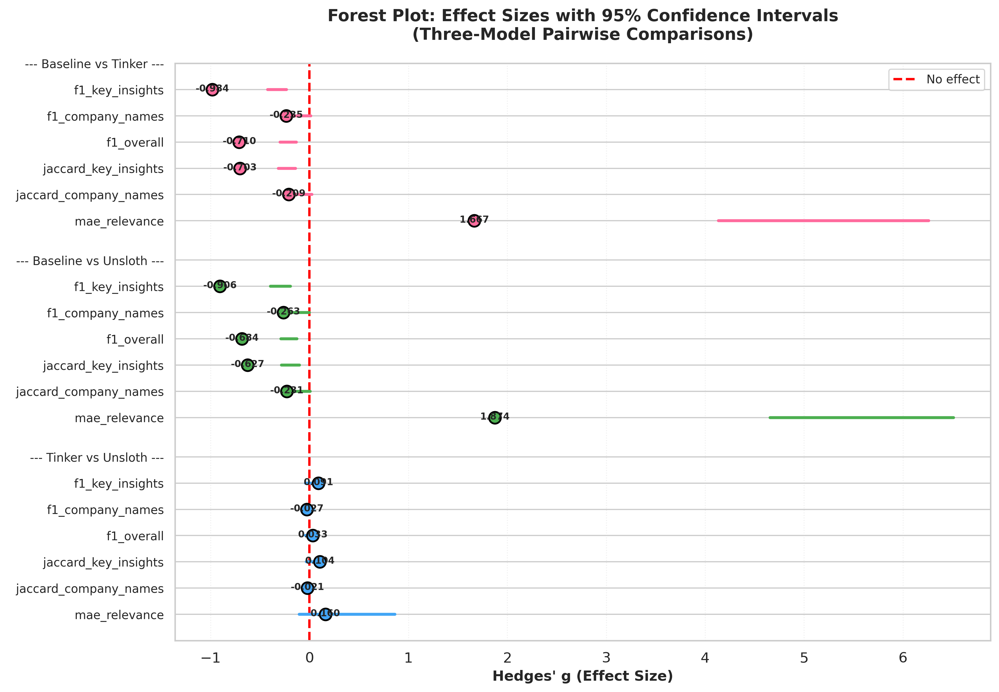

**Key Insight:** Baseline vs fine tuned differences are significant (p < 0.0001) with medium to large effect sizes (Cohen's d 0.68 to 0.71 for overall F1). No significant difference between Tinker and Unsloth (p=0.698).

---

### 2. JSON Validation Comparison

**Bar chart showing JSON validity rates across all three models.**

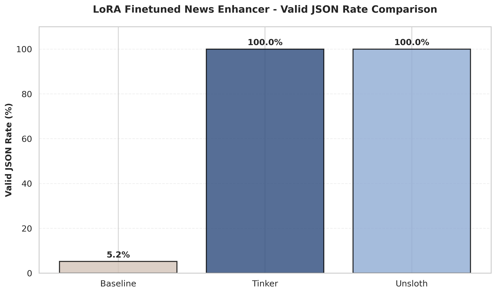

**Key Insight:** Baseline output was invalid JSON for 91 of 96 items (5.2% validity), while both fine-tuned models achieve 100% validity.

---

### 3. F1 Score by Field

**Comparison of F1 scores across key_insights, company_names, and overall metrics.**

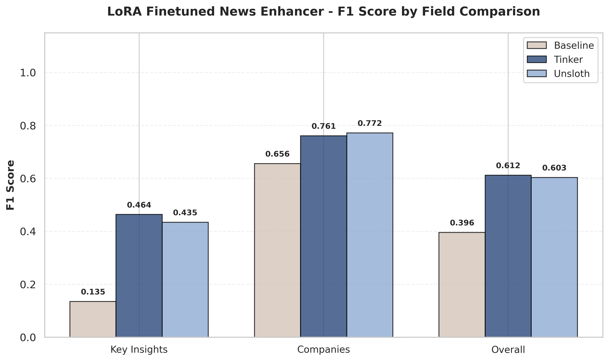

**Key Insight:** Fine-tuned models improve on every field, though not all gains reach significance at n=96. Key insights improve strongly and significantly (F1 0.135 → 0.464, p < 1e-8). Company names improve too (0.656 → 0.761), but the difference is **not statistically significant** (p = 0.096, power = 0.63). The baseline already extracts company names reasonably well, and a larger test set would be needed to confirm a real gain there.

---

### 4. Precision/Recall Comparison

**Model performance breakdown showing precision and recall for each model.**

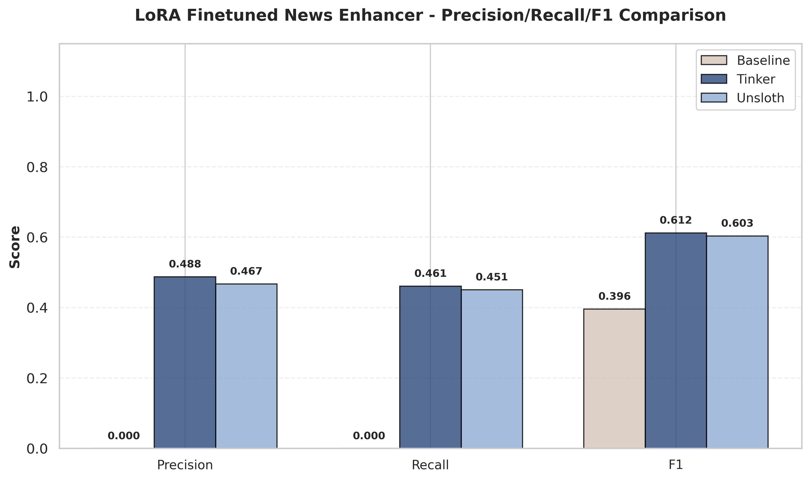

**Key Insight:** Fine-tuned models achieve balanced precision and recall, while baseline shows poor performance on both metrics.

---

### 5. Relevance Error Distribution

**MAE (Mean Absolute Error) and R² visualization for relevance score predictions.**

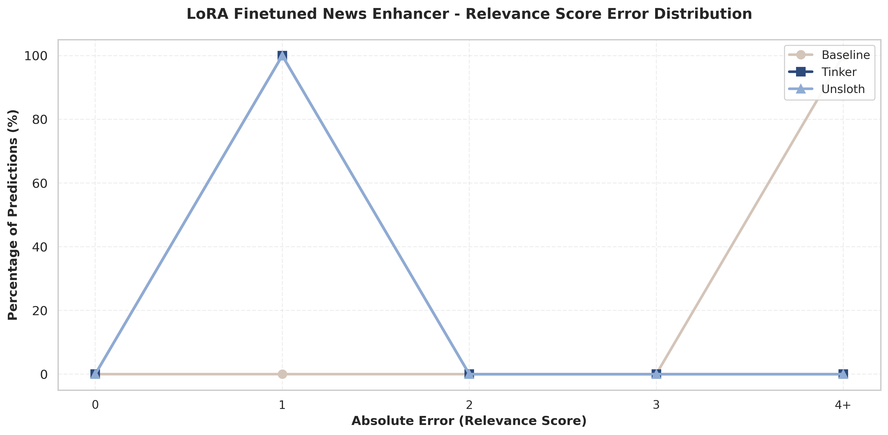

**Key Insight:** Baseline MAE is 6.98, while the fine tuned model MAE values are 1.43 and 1.80. Unsloth has adjusted R² of 0.44 compared with 0.18 for Tinker. The MAE difference between the two fine tuned models is not statistically significant (p = 0.126).

---

### 6. Response Length Box Plot

**Box plot showing response length distribution, highlighting baseline's empty outputs.**

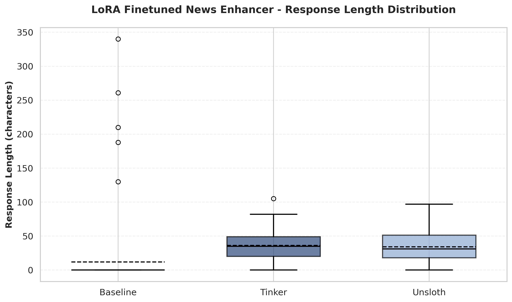

**Key Insight:** Baseline produces extremely short responses, while fine-tuned models generate longer structured outputs. The evaluation files record averages only (see Response Characteristics).

---

### 7. Response Length Violin Plot

**Distribution analysis of response lengths across all three models.**

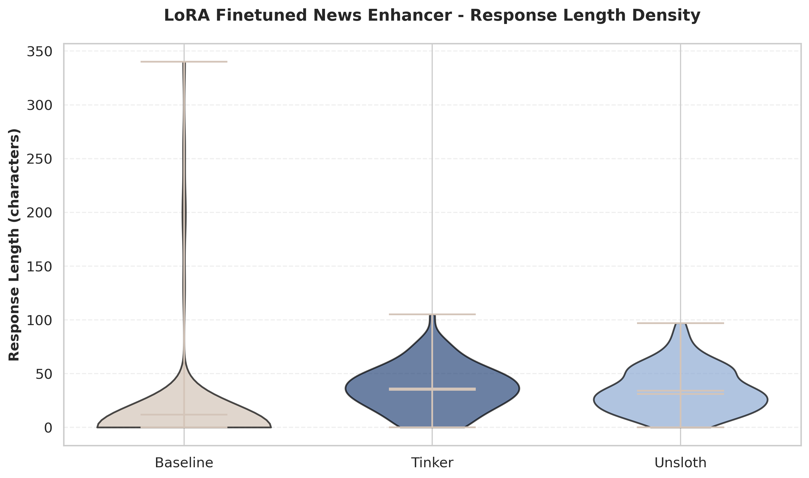

**Key Insight:** Fine-tuned models show consistent, narrow distributions, while baseline shows high variance and skew toward empty outputs.

---

### 8. Word Count Box Plot

**Consistency comparison of word counts across models.**

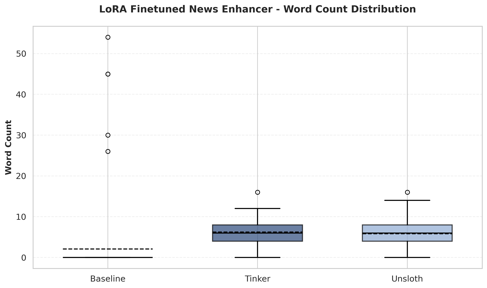

**Key Insight:** Fine-tuned models produce more words per output than the baseline, which produces minimal output. The evaluation files record no median word counts.

---

### 9. Response Length Histogram

**Frequency distribution of response lengths.**

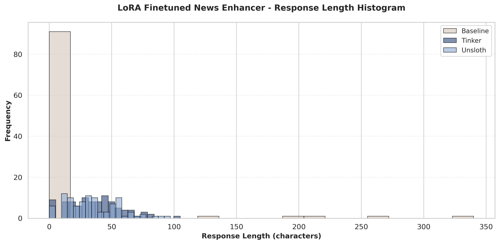

**Key Insight:** Baseline responses cluster at low character counts, while the fine tuned model responses cluster at higher character counts.

---

### 10. Statistical Summary Heatmap

**Metrics overview showing the evaluation metrics in a heatmap.**

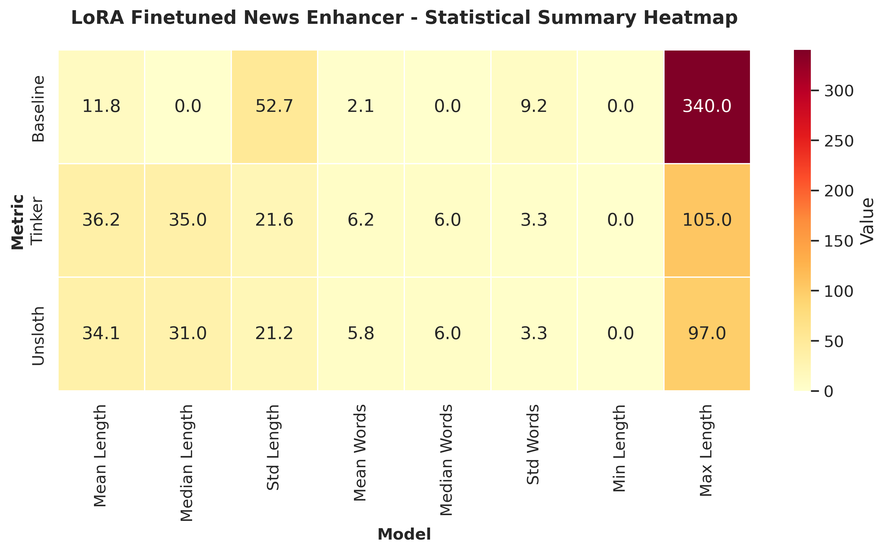

**Key Insight:** The heatmap summarizes the recorded metrics. The fine tuned models have higher aggregate scores than the baseline on most displayed measures, but not every field level difference is statistically significant.

---

### 11. ROUGE Scores Comparison

**ROUGE-1, ROUGE-2, and ROUGE-L scores for all three models.**

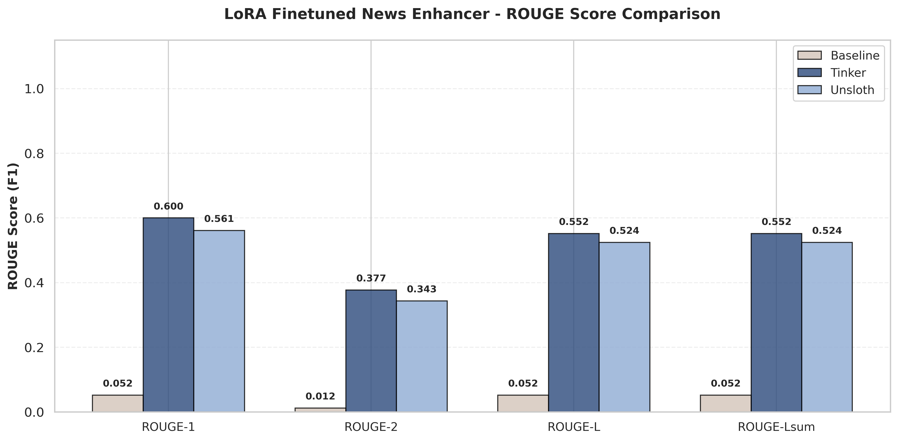

**Key Insight:** Fine-tuned models achieve much higher ROUGE scores, indicating closer lexical overlap with the reference annotations. Note that ROUGE here is computed over the full serialized JSON response rather than the `summary` field alone, so it largely reflects structural fidelity. The baseline's low score follows from its 5.2% JSON validity.

---

### 12. Output Consistency (CV)

**Coefficient of variation analysis showing output consistency.**

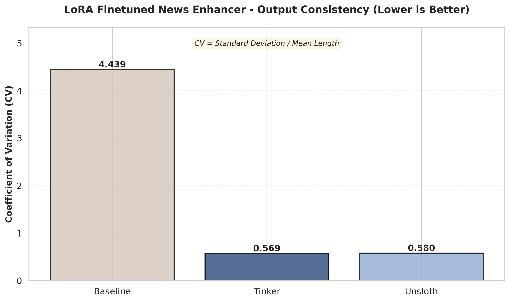

**Key Insight:** The fine tuned models have lower coefficients of variation for response length than the baseline.

---

### 13. BERTScore Comparison

**Semantic similarity metrics using BERTScore.**

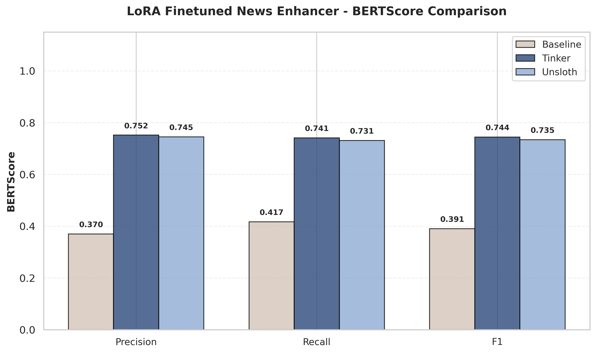

**Key Insight:** Fine-tuned models achieve BERTScore F1 of ~0.74, while baseline scores only 0.39 due to empty/invalid outputs.

---

### Summary of Visualization Insights

| Visualization | Key Finding |
|---------------|-------------|
| **Forest Plot** | Significant vs baseline (p < 0.0001), medium to large effect sizes (d 0.68 to 0.71) |
| **JSON Validation** | Baseline: 5.2% validity ❌ / Fine-tuned: 100% validity ✅ |
| **F1 Score by Field** | Overall F1 0.40 → 0.61; company name gain not significant (p = 0.096) |
| **Precision/Recall** | Balanced performance in fine-tuned models |
| **Relevance Error** | 4.9x lower error for Unsloth (MAE: 6.98 → 1.43) |
| **Response Length** | Baseline produces empty outputs, fine-tuned models consistent |
| **Word Count** | Fine-tuned models produce more words than baseline (no medians recorded) |
| **Statistical Heatmap** | Summary view of all metrics |
| **ROUGE Scores** | Higher overlap with the reference JSON |
| **Output Consistency** | Lower variance in fine-tuned models |
| **BERTScore** | 0.39 → 0.74; the baseline value reflects empty outputs |

**Overall Conclusion:** The 13 charts show the same pattern as the tables. Both fine tuned models produce valid structured output and the baseline does not.

---


## 🔄 Comparison with v1

### Project Evolution

| Aspect | v1.0 (Previous) | v2.0 (Current) | Improvement |
|--------|-----------------|----------------|-------------|
| **Dataset Size** | 101 examples | 460 examples | 4.5x larger |
| **Training Examples** | 101 | 364 | 3.6x more |
| **Test Examples** | 5 scored (from the training file) | 96 held out | Larger held out test set |
| **Model Comparison** | Three models, 5 item check | Three models, 96 items | Larger comparison |
| **Hyperparameters** | Ad-hoc | Matched LoRA rank and alpha | Controlled comparison |
| **Evaluation Metrics** | Basic | Comprehensive | 13 visualizations |
| **Statistical Analysis** | None | Full inference | p-values, effect sizes |

### Key Improvements in v2

1. **Larger Dataset:** 4.5 times as many examples as v1
2. **Matched LoRA Settings:** Both models used rank 32 and alpha 32; other training and evaluation details differed
3. **Baseline Inclusion:** Quantified differences from the unadapted base model on the test set
4. **Statistical Analysis:** Hypothesis tests, effect sizes and confidence intervals
5. **Comprehensive Evaluation:** 13 visualizations, 30+ metrics
6. **Debugging Journey:** train_on_responses_only fix and JSON stopping rule
7. **Documentation:** README with metrics checked against the evaluation files (see [Corrections](#-corrections))

### Links

- **v1.0 Repository:** [llama-tinker-lora-news-enhancer](https://github.com/youshen-lim/llama-tinker-lora-news-enhancer)
- **v2.0 Repository:** [llama-tinker-lora-news-enhancer-v2](https://github.com/youshen-lim/llama-tinker-lora-news-enhancer-v2)

---

## 💡 Lessons Learned

### Key Insights from the Fine-Tuning Journey

This section records lessons from implementing and debugging the Tinker API and Unsloth training approaches.

---

### 1. 🔧 Data Formatting is Framework-Specific

**Critical Discovery:** Tinker API and Unsloth have fundamentally different data format requirements.

| **Aspect** | **Tinker API** | **Unsloth** |
|------------|----------------|-------------|
| **Input Format** | Raw `'messages'` field | Pre-formatted `'text'` field |
| **Chat Template** | Applied automatically | Must be applied manually |
| **Special Tokens** | Added internally | Must be added manually |
| **Persistence** | Reads from file each time | Requires saving formatted data to disk |

**Root Cause of Initial Failures:**
- Unsloth's `train_on_responses_only()` searches for delimiter strings in the `'text'` field
- If data has `'messages'` field instead, delimiters are not found → loss masking fails → contamination
- The formatted dataset must be persisted to disk to ensure consistency across training sessions

**Solution:**
```python
# Save formatted dataset to disk for persistence
formatted_dataset.to_json('news_train_data_formatted.jsonl', orient='records', lines=True)
```

**Recommendation:** Always verify data format compatibility before training and persist formatted datasets to disk.

---

### 2. 🐛 Debugging Journey: From 100% to 0% Contamination

**Initial Problem:** Unsloth model showed 100% contamination (prompt leakage + multiple JSONs per output)

**Fix #1: Decoding Bug → Eliminated Prompt Leakage**

**Root Cause:** `decode(outputs[0])` decoded entire sequence (input + output)
```python
# ❌ WRONG: Decodes input + output
generated_text = tokenizer.decode(outputs[0], skip_special_tokens=True)

# ✅ CORRECT: Decode only new tokens
input_length = inputs['input_ids'].shape[1]
generated_text = tokenizer.decode(outputs[0][input_length:], skip_special_tokens=True)
```

**Result:** Prompt leakage 100% → 0% ✅

**Fix #2: Stopping Criteria → Eliminated Multiple JSONs**

**Root Cause:** EOS tokens do not understand JSON structure
- Tried `eos_token_id=[128001, 128009]` → Failed (100% contamination)
- EOS tokens signal "end of response" but cannot detect closing braces `}`

**Solution:** Custom stopping criteria with JSON structure awareness
```python
class JSONStoppingCriteria(StoppingCriteria):
    def __call__(self, input_ids, scores, **kwargs):
        # Decode and check for complete JSON
        text = tokenizer.decode(input_ids[0][input_length:], skip_special_tokens=True)
        return is_complete_json(text)
```

**Result:** Multiple JSONs 100% → 0% ✅

**Lesson:** The custom brace counting stopping rule prevented extra JSON objects in the Unsloth evaluation.

---

### 3. ✅ Baseline Comparison Quantified the Test Set Difference

**Finding:** The unadapted baseline returned valid JSON for 5 of 96 test items.

**Why This Matters:**
- Showed that both LoRA fine tuned models produced valid JSON more often than the baseline on this test set
- Quantified the difference as 19 times the JSON validity and 55% higher overall F1 for Tinker (0.396 to 0.612)
- Established a baseline for future comparisons

**Recommendation:** Always include baseline evaluation to:
- Quantify improvement magnitude
- Justify fine-tuning investment
- Identify whether the task requires fine-tuning at all

---

### 4. 🏆 No Significant Overall F1 or Relevance MAE Difference Detected

**Comparative Results:**

| **Metric** | **Tinker API** | **Unsloth** | **Statistical Significance** |
|------------|----------------|-------------|------------------------------|
| **F1 Score** | 0.612 | 0.603 | p=0.698 (no significant difference) |
| **JSON Validity** | 100% | 100% | Both 96 of 96 |
| **MAE (Relevance)** | 1.80 | 1.43 | p=0.126 (no significant difference) |

**Key Insight:** The test found no statistically significant difference in overall F1 (p = 0.698) or relevance MAE (p = 0.126).

**Training time is not comparable.** I did not measure Tinker wall clock training time, and it needs a rerun. The Tinker log records time per step, not a total, and the run saved a checkpoint after every step. The Unsloth artifacts record two different runs: 3 minutes 39 seconds in the notebook output and 4.91 minutes in `unsloth_models/model_metadata.json`. I have not confirmed which run produced the evaluated model.

**The recorded test metrics do not establish a preferred framework. Infrastructure differences include:**
- **Tinker API:** Managed service with built in step logging
- **Unsloth:** Local control on a free Colab GPU

---

### 5. 📊 Dataset Size and Quality Matter

**Evolution:**
- v1 (Pilot): 101 examples → Proof of concept
- v2: 460 examples → 4.5x expansion

**Benefits of Larger Dataset:**
- Enabled statistical significance testing on a 96 item test set
- Supported comprehensive evaluation (13 visualizations, multiple metrics)

**Recommendation:** Invest in quality annotations. I did not test how much of the v2 gain comes from the larger dataset.

---

### 6. 🔬 Multi Metric Evaluation

**Multi-Metric Approach:**
- **JSON Validity:** Structural correctness (100% for both fine-tuned models)
- **F1 Score:** Overall quality (0.61 for both)
- **MAE:** Relevance score accuracy (1.43-1.80)
- **13 Visualizations:** Revealed model behavior patterns
- **Statistical Tests:** Confirmed significance (p<0.001 vs baseline)

**Why Multiple Metrics:**
- Single metrics can be misleading
- Different metrics reveal different aspects of model behavior
- Several metrics together give a fuller picture than one metric

**Recommendation:** Use multiple complementary metrics to describe different aspects of test set performance.

---

### 7. 📝 Training Logging: Framework Differences

**Tinker API:**
- ✅ Records loss, learning rate, token counts and timing in `metrics.jsonl`
- ✅ Logs every step: loss, learning rate, tokens, timing
- ❌ Weights & Biases NOT needed

**Unsloth:**
- ✅ Logs loss through TRL to the console every 10 steps (`logging_steps=10`)
- ✅ Writes `trainer_state.json` at each checkpoint
- ❌ Does not write a per step metrics file like Tinker

**Recommendation:**
- For Tinker: Use built-in logging (no additional setup needed)
- For Unsloth: Add a tracker such as W&B if you need more than the TRL logs

---

### 8. ⚙️ Hyperparameter Optimization Insights

**Actual Settings (This Project):**
- Learning Rate: 2e-4 (standard LoRA)
- Batch Size: 4
- Training Steps: 455 (5 epochs)
- Results: Overall F1 0.603 for Unsloth and 0.612 for Tinker on the held out test set

**Untested Ideas:** a higher learning rate, a larger effective batch size and more steps. Both models already used LoRA rank 32.

**Lesson:** Results with standard settings are shown above. I have not tested other settings. The improvement over baseline is statistically significant (p < 0.0001, Cohen's d = -0.71, a medium to large effect).

---

### What Worked Well

- ✅ 80/20 split (364 train / 96 test), not temporal
- ✅ `train_on_responses_only` masking - eliminated contamination
- ✅ Standard LoRA learning rate (2e-4), used in both executed runs
- ✅ Small batch size (4), used in the executed Unsloth run
- ✅ 5 epochs (455 steps), used in the executed Unsloth run
- ✅ Three-model comparison on one held out test set

### Opportunities for Improvement

- 💡 Test a higher learning rate with Tinker's learning rate helper
- 💡 Test a larger effective batch size via gradient accumulation
- 💡 Test more training steps
- 💡 Add a validation set and early stopping based on validation metrics
- 💡 Measure Tinker wall clock training time

---

### 🎯 Summary: Critical Takeaways

1. **Data formatting is framework-specific** - verify compatibility and persist formatted data
2. **Debugging requires systematic investigation** - from 100% contamination to 0% through structured problem-solving
3. **Baseline comparison quantifies the observed test set differences**
4. **Tinker and Unsloth showed no statistically significant difference in overall F1 or relevance MAE on this test set**
5. **Dataset size matters** - the 4.5x expansion enabled a 96 item test set
6. **Multiple metrics describe different aspects of test set performance**
7. **Training logging varies by framework** - plan accordingly
8. **Hyperparameter tuning is untested** - results above use standard settings

**My detailed debugging notes are in a private project workspace and are not public.**

---

---

## 🔮 Future Work

### Short-Term Improvements

1. **Hyperparameter Optimization**
   - Test a higher learning rate and a larger effective batch size
   - Experiment with a LoRA rank above 32
   - Train for more steps

2. **Dataset Expansion**
   - Scale to 1000+ examples for better robustness
   - Include more diverse news sources
   - Add error analysis and edge case handling

3. **Model Deployment**
   - Publish the v2 adapter weights
   - Run the v2 model in the News Analyst agent and record the result
   - Export to GGUF format for Ollama
   - Optimize for CPU inference
   - Create Docker container for easy deployment

### Long-Term Vision

1. **Multi-Task Learning**
   - Extend to other newsletter types (tech, finance, science)
   - Add sentiment analysis and trend detection
   - Implement multi-lingual support

2. **Active Learning**
   - Implement uncertainty sampling for annotation
   - Continuous learning from production data
   - Automated quality monitoring

3. **Integration Enhancements**
   - Real-time processing pipeline
   - API endpoint for external applications
   - Dashboard for monitoring and analytics

---

## 📚 References

### Related Documentation

- **Training Data:** `./training_data/` directory (460 annotated examples)
- **Evaluation Results:** `./evaluation_results/` directory (13 visualizations, metrics)
- **Model Configurations:** Documented in [Training Configuration](#-training-configuration) section

### Project Links

- **Current Repository (v2.0):** [llama-tinker-lora-news-enhancer-v2](https://github.com/youshen-lim/llama-tinker-lora-news-enhancer-v2)
- **Previous Repository (v1.0):** [llama-tinker-lora-news-enhancer](https://github.com/youshen-lim/llama-tinker-lora-news-enhancer)
- **Hugging Face (v2):** [Truthseeker87/llama-tinker-lora-news-enhancer-v2](https://huggingface.co/Truthseeker87/llama-tinker-lora-news-enhancer-v2)
- **Hugging Face Profile:** [Truthseeker87](https://huggingface.co/Truthseeker87)

### Technical References

- **LoRA Paper:** Hu et al., 2021 - "LoRA: Low-Rank Adaptation of Large Language Models" [[arXiv]](https://arxiv.org/abs/2106.09685)
- **Llama 3.2:** Meta AI - [Llama 3.2 Model Card](https://huggingface.co/meta-llama/Llama-3.2-1B)
- **Unsloth:** [Unsloth GitHub](https://github.com/unslothai/unsloth) - Optimized fine-tuning library
- **Tinker API:** [Thinking Machines Tinker](https://thinkingmachines.ai/tinker/) - Managed fine-tuning service
- **ROUGE:** Lin, 2004 - "ROUGE: A Package for Automatic Evaluation of Summaries"
- **BERTScore:** Zhang et al., 2020 - "BERTScore: Evaluating Text Generation with BERT" [[arXiv]](https://arxiv.org/abs/1904.09675)

---

## 📄 License

This project is licensed under the MIT License, which covers the files in this repository. The [Llama 3.2 Community License](https://huggingface.co/meta-llama/Llama-3.2-1B) governs the Llama 3.2 base model (`meta-llama/Llama-3.2-1B`).

```
MIT License

Copyright (c) 2025 Aaron (Youshen) Lim

Permission is hereby granted, free of charge, to any person obtaining a copy
of this software and associated documentation files (the "Software"), to deal
in the Software without restriction, including without limitation the rights
to use, copy, modify, merge, publish, distribute, sublicense, and/or sell
copies of the Software, and to permit persons to whom the Software is
furnished to do so, subject to the following conditions:

The above copyright notice and this permission notice shall be included in all
copies or substantial portions of the Software.

THE SOFTWARE IS PROVIDED "AS IS", WITHOUT WARRANTY OF ANY KIND, EXPRESS OR
IMPLIED, INCLUDING BUT NOT LIMITED TO THE WARRANTIES OF MERCHANTABILITY,
FITNESS FOR A PARTICULAR PURPOSE AND NONINFRINGEMENT. IN NO EVENT SHALL THE
AUTHORS OR COPYRIGHT HOLDERS BE LIABLE FOR ANY CLAIM, DAMAGES OR OTHER
LIABILITY, WHETHER IN AN ACTION OF CONTRACT, TORT OR OTHERWISE, ARISING FROM,
OUT OF OR IN CONNECTION WITH THE SOFTWARE OR THE USE OR OTHER DEALINGS IN THE
SOFTWARE.
```

### Citation

If you use this work in your research or project, please cite:

```bibtex
@misc{lim2025llamanewsenhancer,
  author = {Lim, Youshen (Aaron)},
  title = {Llama 3.2-1B LoRA Fine-Tuning for News Analysis: Enhanced Semantic Metadata Generation},
  year = {2025},
  publisher = {GitHub},
  journal = {GitHub repository},
  howpublished = {\url{https://github.com/youshen-lim/llama-tinker-lora-news-enhancer-v2}},
}
```

---

## 🙏 Acknowledgments

- **Meta AI** for the Llama 3.2 base model
- **Thinking Machines** for the Tinker API platform
- **Unsloth Team** for the optimized fine-tuning library
- **Hugging Face** for the transformers library and model hosting
- **Google Colab** for free GPU access

---

## 📧 Contact

**Author:** Aaron (Youshen) Lim
**Email:** yl3566@cornell.edu
**GitHub:** [@youshen-lim](https://github.com/youshen-lim)
**Hugging Face:** [Truthseeker87](https://huggingface.co/Truthseeker87)

---

## ⭐ Star History

If you find this project useful, please consider giving it a star! ⭐

[](https://star-history.com/#youshen-lim/llama-tinker-lora-news-enhancer-v2&Date)

---

## 🎓 Educational Value

This project documents:
- **LoRA Fine-Tuning:** Practical implementation with real-world data
- **Model Comparison:** Evaluation of managed and local LoRA training on the same 96 item test set
- **Statistical Analysis:** Reported hypothesis tests, effect sizes and confidence intervals
- **Documentation:** Published corrections when figures did not match the evaluation files

---

## 📝 Corrections

I corrected the following items on **November 20, 2026** after I rechecked this README against the training notebook, the training logs, the data files and the evaluation files. The data, models and evaluation code are unchanged.

| Item | Previously stated | Corrected to | Cause |
|------|-------------------|--------------|-------|
| Unsloth LoRA rank and alpha | Likely Unsloth defaults, r = 16, alpha = 16 | r = 32, alpha = 32, dropout 0.05 | The notebook LoRA cell and the saved adapter config both use 32. |
| Recommended LoRA rank | Raise rank to 32 (vs default 16) in future runs | Removed | Both models already used rank 32. |
| Recommended learning rate | 1.6e-3 from Tinker's `get_lr()`; effective batch 128; 1000+ steps | Listed as untested ideas | No notebook cell or log contains `get_lr` or 1.6e-3. |
| Unsloth precision | 4 bit quantization support; `load_in_4bit=True` in the example | Trained and evaluated in 16 bit | The notebook sets `load_in_4bit = False`. |
| Fine tuned JSON validity | Section explaining a 5% failure rate (95% validity) | 100% (96 of 96) for both models | The 95% figure had no source. |
| Tinker training time | 8.51 minutes; Unsloth 2.33 times faster | Not measured; needs rerun | 8.51 is the time of the final training step in seconds, not the total run time. |
| Training time estimates | 20 to 30 minutes (Tinker), 30 to 45 minutes (Unsloth) | Removed | These were estimates written before training. |
| Baseline model | Untrained Llama 3.2 1B Instruct | Llama 3.2 1B base | The baseline metadata file names `meta-llama/Llama-3.2-1B`. |
| Effect size labels | Cohen's d = -0.71 (large effect); d > 0.7 proves significance | Medium to large effect; p values establish significance | By the usual convention, 0.8 is a large effect. The Unsloth F1 effect is 0.68. |
| Split method | Temporal 80/20 (earlier articles for training, later for testing) | 80/20 split, not temporal | Both sets contain items from December 2024 through October 2025. |
| Sponsored items | 20 (4.3% of total) | 23 (18 train, 5 test) | Count of the `metadata.is_sponsored` field in the published files. |
| Merged content issues | 8 items (1.7% of total) | Removed | The published files have no field that records merged content. |
| Validation set | No validation set needed | No validation set was used | Training loss alone cannot support model selection or early stopping. |
| Response length | Median lengths and median word counts | Average lengths from the evaluation file | The evaluation files record averages only. |
| Model weights | Coming soon; `Truthseeker87/llama-news-enhancer-lora` | Link to `Truthseeker87/llama-tinker-lora-news-enhancer-v2`; no weight files yet | The named repository does not exist. The v2 repository exists but holds no weight files. |
| Weight file sizes | 10 to 50 MB, 2 to 4 GB, 500 MB to 1 GB | Removed | No weight files are published to measure. |
| News Analyst integration | v2 serves as the semantic layer of a production system; processing time, workflow time, completion rate and quality figures | Agent configuration references the v1 adapter; v2 not shown running in the pipeline | The agent configuration names the v1 Ollama model. The performance figures had no source. |
| LoRA vs full fine tuning | 10 to 100 times less memory, 100 to 1000 times smaller, 2 to 3 times faster | Removed | I did not run full fine tuning. |
| Tinker model support | Up to Llama 70B and Qwen 235B | Qwen-235B-A22B at launch, with the announcement link | The announcement does not name Llama 70B. |
| Unsloth speed | 2 to 10 times faster | About 2 times faster, labeled as a vendor statement | The current Unsloth documentation states 2 times. |
| Unsloth logging | No built in training metrics logging | Logs loss through TRL and writes trainer state at checkpoints | The notebook trainer logs every 10 steps. |
| Tinker client example | `TinkerClient` and `pip install tinker-client` | Pointer to the Tinker docs | The notebook uses `tinker.ServiceClient`. |
| Generalization claims | Human level performance, not memorization | Removed | No human baseline or memorization test exists. |
| Status | Production-Ready, production quality, production-ready reliability | Removed | No deployment of a v2 model supports these statements. |
| Interpretation claims | LoRA fine tuning is essential; Tinker and Unsloth have comparable performance; comprehensive evaluation prevents overfitting; 5 epochs sufficient for convergence | Stated as results on this test set only | The test compared one unadapted base model with two LoRA models on one test set. A difference that is not statistically significant does not show equal performance. No validation set was used. |
| Broken links | News-Analyst-MCP-Agent repository; tinker.thinkingmachin.es; internal settings anchor | Removed or replaced | The repository is private, the domain fails, and the anchor had no heading. |
| License (November 21, 2026) | MIT License only | MIT License for the repository files; Llama 3.2 Community License for the Llama 3.2 base model | The README did not name the license of the base model. |

I rechecked the dataset counts, the JSON validity counts, the F1, Jaccard, BERTScore, MAE and adjusted R squared values, the p values, the Cohen's d values and both LoRA configurations against the published evaluation files, adapter configurations and the training notebook.

The following figures were corrected on **July 26, 2026** after re-verification against the
evaluation artifacts published in this repository. The underlying data, models, and evaluation
code are unchanged — only the reported numbers were wrong.

| Item | Previously stated | Corrected to | Cause |
|------|-------------------|--------------|-------|
| Headline improvement | +162% quality improvement (F1: 0.40 → 0.61) | **+55%** overall F1 (0.396 → 0.612) | The +162% did not correspond to the F1 values quoted beside it; the nearest matching figure was Jaccard on key insights (+168%). |
| Exact Match Rate | ~15–25% (both fine-tuned models) | **7.3%** Tinker, **3.1%** Unsloth | Estimated rather than read from `three_model_quality_metrics_aggregated_*.json`. |
| R² (Relevance) | -0.089 / 0.297 / 0.435 | **-4.27 / 0.18 / 0.44** (adjusted R²) | Only the Unsloth value matched the computed adjusted R²; the metric is now labelled correctly. |
| "Consistent improvement across all fields" | — | Qualified | Company-name F1 improves but is **not** statistically significant (p = 0.096). |

All p-values, Cohen's d values, JSON validity rates, F1/Jaccard tables, BERTScore, MAE, dataset
counts, and the zero-train/test-leakage claim were re-checked and are **accurate as originally
published**.

---

**Last Updated:** November 20, 2026
**Version:** 2.0

